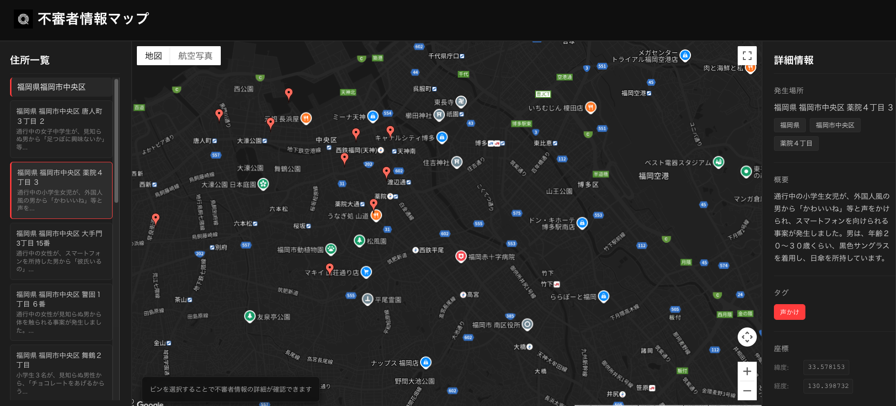
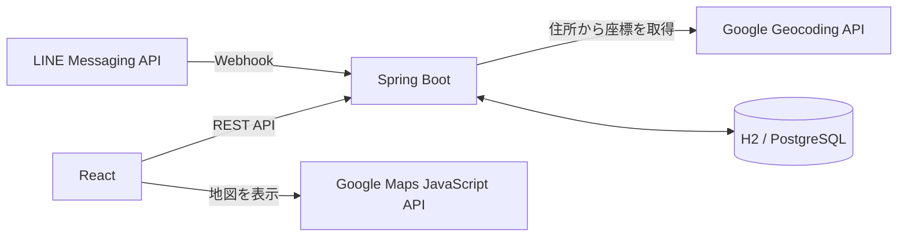

# 不審者情報マップ

LINE から受信した不審者情報を住所解析・Geocoding して保存し、Google Maps 上に表示する Web アプリケーションです。

## 主な機能

- LINE のテキストメッセージから発生日時、住所、タグ、概要を抽出
- Google Geocoding API で住所を緯度・経度へ変換
- 不審者情報をデータベースに保存
- 保存された情報を Google Maps 上にマーカーとして表示
- 住所一覧またはマーカーから報告の詳細を表示

## 工夫した点

### 住所表記の違いを考慮した Geocoding

日本語住所は、人間には同じ意味に見えても表記形式によって Geocoding API の結果が変わります。開発当初は `3丁目15` を `3-15` のように機械的に変換したことで `ZERO_RESULTS` になったり、`partial_match=true` や `types=route` の意図しない地点が返ったりしました。

そこで、日本語として意味のある「丁目」などを残しながら表記を整え、詳細住所で取得できない場合は、都道府県・市区町村・丁目を維持したまま番地以降を右側から段階的に短くして再検索するようにしました。また、API が返した候補を順に確認し、`partial_match=true` の候補と、`types` に `route` を含む候補を除外しています。

これにより、詳細住所で取得できない場合も、道路として解釈された候補や部分一致の候補を避けながら、入力された必須住所部分の範囲内で座標を取得できる構成にしました。設計と精度上の制約は [`docs/integrations/google-maps.md`](docs/integrations/google-maps.md) を参照してください。

### LINE Messaging API との Webhook 連携

LINE から受信したメッセージをアプリケーションへ取り込むため、Spring Boot に Webhook エンドポイントを実装しました。接続検証では、ngrok を使ってバックエンドの `localhost:8080` を HTTPS で外部公開し、LINE Platform からのリクエストを受信しました。

開発当初は LINE Bot SDK による Webhook の自動受付を試しましたが、当時の環境ではエンドポイントのマッピングを確認できず、処理経路の切り分けが難しい状態でした。そこで、現在は `POST /line/callback` を Controller で明示し、生のリクエストボディの署名を検証してから Jackson で解析し、メッセージの解析と保存を Service に委譲しています。これにより、HTTP 受信から保存までの責務と処理経路をコード上で追えるようにしました。

詳しい構成は [`docs/integrations/line-messaging-api.md`](docs/integrations/line-messaging-api.md)、障害の確認方法は [`docs/operations/troubleshooting.md`](docs/operations/troubleshooting.md) を参照してください。

## システム構成

## 使用技術

| 分類             | 技術                                                          |
| ---------------- | ------------------------------------------------------------- |
| フロントエンド   | React 19、Vite 7、JavaScript、CSS、Google Maps JavaScript API |
| バックエンド     | Java 17、Spring Boot 3.5、Spring Data JPA                     |
| データベース     | PostgreSQL、H2（ローカル・自動テスト）                        |
| 外部連携         | LINE Messaging API、Google Geocoding API                      |
| ビルド・品質管理 | Maven Wrapper、npm、ESLint                                    |

## セットアップ

必要なソフトウェア、ローカル設定、データベースの準備、フロントエンドとバックエンドの起動、LINE Webhook の確認方法は [`docs/development/setup.md`](docs/development/setup.md) を参照してください。

## API

| メソッド | パス             | 用途                                     |
| -------- | ---------------- | ---------------------------------------- |
| `POST`   | `/line/callback` | LINE の Webhook を受信して報告を登録する |
| `GET`    | `/api/reports`   | 登録済みの報告一覧を取得する             |

## ドキュメント

- [`docs/architecture/system-overview.md`](docs/architecture/system-overview.md): システム構成、コンポーネントの責務、登録・閲覧データフロー
- [`docs/development/setup.md`](docs/development/setup.md): 必要なソフトウェア、ローカル設定、起動方法、変更後の検証手順
- [`docs/development/database.md`](docs/development/database.md): DB Profile、H2、Docker PostgreSQL、本番用設定の現状
- [`docs/development/configuration-management.md`](docs/development/configuration-management.md): 環境別設定、秘密情報、Git 管理区分の方針
- [`docs/integrations/line-messaging-api.md`](docs/integrations/line-messaging-api.md): LINE Webhook の構成、開発手順、セキュリティ方針
- [`docs/integrations/google-maps.md`](docs/integrations/google-maps.md): Google Maps・Geocoding 連携の設計、実装、精度上の制約
- [`docs/operations/troubleshooting.md`](docs/operations/troubleshooting.md): 開発・連携時の問題の切り分け方法
