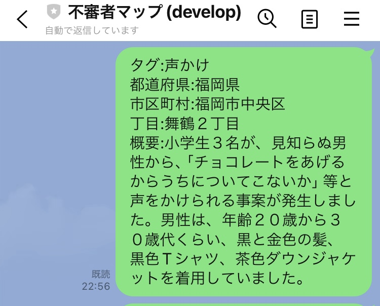

# ローカル開発環境のセットアップ

## 目的

新しい開発環境で、不審者情報マップのバックエンドとフロントエンドを起動するまでの手順を示す。

通常の動作確認にはファイル型 H2 を使用するため、PostgreSQL と Docker は不要である。PostgreSQL はデータベース互換性を確認するとき、ngrok は LINE Webhook をローカル環境で確認するときだけ使用する。

設定ファイルの Git 管理区分と認証情報の扱いは [`configuration-management.md`](configuration-management.md)、各データベース Profile の詳細は [`database.md`](database.md) を参照する。

## 1. 必要なソフトウェアと外部サービス

### 通常のローカル起動に必要なもの

| 項目                 | 要件・用途                                                             |
| -------------------- | ---------------------------------------------------------------------- |
| Java                 | Java 17。バックエンドのビルドと起動に使用する                          |
| Node.js              | 20.19 以上または 22.12 以上。Vite 7 の要件を満たすバージョンを使用する |
| npm                  | `frontend/package-lock.json` に基づく依存関係のインストールに使用する  |
| Google Maps Platform | Maps JavaScript API と Geocoding API を有効化した API キーを用意する   |
| LINE 公式アカウント  | 現在のバックエンド起動に必要なチャネルシークレットを用意する           |

Maps JavaScript API と Geocoding API には、用途に合った制限を設定した別々の API キーを使用することを推奨する。フロントエンド用のキーはブラウザへ配信されるため、HTTP リファラーと利用可能な API を制限する。詳しくは [`../integrations/google-maps.md`](../integrations/google-maps.md) を参照する。

### 確認内容に応じて必要なもの

| 項目                    | 必要になる場合                                                |
| ----------------------- | ------------------------------------------------------------- |
| PostgreSQL 15 と Docker | `local-postgres` Profile で PostgreSQL 互換性を確認する場合   |
| ngrok                   | ローカルのバックエンドを LINE Platform から到達可能にする場合 |

## 2. ローカル設定を作成する

認証情報の実値は、次の Git 管理対象外ファイルだけに記載する。

- バックエンド: `backend/config/application-local-secrets.properties`
- フロントエンド: `frontend/.env.development`

リポジトリルートで次を実行し、両方が ignore 対象であることを確認してから実値を入力する。

```bash
git check-ignore -v backend/config/application-local-secrets.properties
git check-ignore -v frontend/.env.development
```

### バックエンド

`backend/config/application-local-secrets.properties` を作成し、次の項目を設定する。`backend/config/` がない場合は先に作成する。

```properties
local.google.geocoding-api-key=YOUR_GOOGLE_GEOCODING_API_KEY
local.line.channel-secret=YOUR_LINE_CHANNEL_SECRET
local.cors.allowed-origins=http://localhost:5173

local.postgres.datasource.url=jdbc:postgresql://localhost:5432/personal_develop_db
local.postgres.datasource.username=YOUR_DATABASE_USER
local.postgres.datasource.password=YOUR_DATABASE_PASSWORD
```

`local-h2` だけを使用する場合、`local.postgres.datasource.*` の3項目は起動に使用されない。`local-postgres` を使用する場合は、実際に作成したデータベースの接続情報と一致させる。

ローカル Profile はこのファイルを Spring Boot 起動時に読み込む。同じ項目を環境変数で指定した場合は環境変数が優先される。対応する環境変数と Profile ごとの設定は [`database.md`](database.md) を参照する。

### フロントエンド

`frontend/.env.development` を作成し、次の項目を設定する。

```dotenv
VITE_API_BASE_URL=http://localhost:8080
VITE_GOOGLE_MAPS_API_KEY=YOUR_GOOGLE_MAPS_JAVASCRIPT_API_KEY
```

Vite はこれらの値を開発サーバーの起動時とビルド時に読み込む。値を変更した場合は開発サーバーを再起動する。`VITE_` で始まる値はブラウザへ配信されるため、秘密情報の保管先として使用しない。

## 3. 依存関係を準備する

フロントエンドの依存関係をロックファイルどおりにインストールする。

```bash
cd frontend
npm ci
```

バックエンドは Maven Wrapper を使用するため、Maven を別途インストールする必要はない。初回のビルドまたは起動時に必要な依存関係がダウンロードされる。

## 4. データベースを準備する

### 通常の動作確認: `local-h2`

事前準備は不要である。Spring Boot の起動時にファイル型 H2 が作成され、データは次に保存される。

```text
backend/.local-data/suspicious-person-map.mv.db
```

このファイルは Git 管理対象外であり、バックエンドを再起動してもデータが残る。

### PostgreSQL 互換性確認: `local-postgres`

PostgreSQL 15 を起動し、`backend/config/application-local-secrets.properties` の URL、ユーザー名、パスワードと一致するデータベースを作成する。現在のローカル PostgreSQL コンテナの構成、起動・停止方法、検証が必要になる変更の基準は [`database.md`](database.md) を参照する。

このリポジトリには Docker Compose 定義がないため、新しい環境向けの PostgreSQL コンテナ作成方法は現時点で標準化されていない。通常の開発開始時は `local-h2` を使用する。

## 5. バックエンドを起動する

通常は `local-h2` Profile を明示して起動する。

```bash
cd backend
SPRING_PROFILES_ACTIVE=local-h2 ./mvnw spring-boot:run
```

標準設定では `http://localhost:8080` で起動する。別のターミナルから次の API を呼び出し、JSON の配列が返ることを確認できる。

```bash
curl http://localhost:8080/api/reports
```

Entity、Repository、カラム、制約、SQL などを変更した場合は、PostgreSQL を準備したうえで `local-postgres` Profile でも確認する。

```bash
cd backend
SPRING_PROFILES_ACTIVE=local-postgres ./mvnw spring-boot:run
```

`prod` Profile は未使用の本番用設定として存在する。本番の接続先と運用基盤は未決定であるため、ローカル開発では使用しない。

## 6. フロントエンドを起動する

バックエンドを起動したまま、別のターミナルで実行する。

```bash
cd frontend
npm run dev
```

ブラウザで `http://localhost:5173` を開く。フロントエンドは `VITE_API_BASE_URL` に設定したバックエンドの REST API へ接続する。

## 7. LINE Webhook を確認する

この手順は、LINE Platform からローカル環境への Webhook と報告登録を確認する場合だけ実施する。

1. `local-h2` または `local-postgres` Profile でバックエンドを起動する。
2. 別のターミナルで ngrok を起動する。
3. LINE Developers の Webhook URL に ngrok の HTTPS URL と `/line/callback` を設定する。

```bash
ngrok http 8080
```

```text
https://YOUR_PUBLIC_HOST/line/callback
```

公開するのは React の `5173` 番ポートではなく、Webhook を受信する Spring Boot の `8080` 番ポートである。

動作確認では、LINE から次の形式のメッセージを送信する。

```text
タグ: 不審な声かけ、つきまとい
日時: 2025年1月1日午後6時30分
都道府県: 福岡県
市区町村: 福岡市中央区
丁目: 天神1丁目
番地以降: 1-1
概要: 通行人への不審な声かけ
```



署名検証、Webhook の処理経路、LINE Developers 側の設定については [`../integrations/line-messaging-api.md`](../integrations/line-messaging-api.md) を参照する。

## 8. 変更を検証する

フロントエンドを変更した場合は、次を実行する。

```bash
cd frontend
npm run lint
npm run build
```

バックエンドを変更した場合は、次を実行する。

```bash
cd backend
./mvnw test
```

起動や外部連携で問題が発生した場合は [`../operations/troubleshooting.md`](../operations/troubleshooting.md) を参照する。
