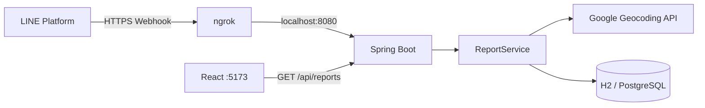

# LINE Messaging API 連携

## 目的

LINE 公式アカウントで受信した不審者情報を Webhook 経由でバックエンドへ取り込み、メッセージを解析してデータベースへ保存する。

この文書は、署名検証を含む現在の実装、接続検証で使用した経路、ローカル接続手順を記載する。接続時の問題の切り分けは [`../operations/troubleshooting.md`](../operations/troubleshooting.md) を参照する。

## 実装と接続検証で使用した経路



| 項目                   | 現在の実装                                      |
| ---------------------- | ----------------------------------------------- |
| Webhook URL            | `POST /line/callback`                           |
| HTTP 受信              | `LineController`                                |
| Webhook 署名検証       | `LineWebhookSignatureVerifier`                  |
| Webhook JSON の解析    | Jackson の `JsonNode`                           |
| メッセージ解析・保存   | `ReportService`                                 |
| 接続検証で使用した経路 | ngrok から Spring Boot の `8080` 番ポートへ転送 |

Controller は Webhook の HTTP 入出力を担当し、署名検証に成功したリクエストからユーザー ID、メッセージ本文、イベントの`timestamp`（UTCの1970年1月1日を起点とするUnix時間のミリ秒値）を抽出して `ReportService` へ渡す。`timestamp`自体にタイムゾーンは含まれないため、日時解析では`Asia/Tokyo`を明示して日本標準時へ変換する。解析は`service.parsing`配下のコンポーネントが担当し、`ReportService`は解析、Geocoding、データベース保存を調整する。

## メッセージ解析

一次情報の文章を解析する。項目名を使った旧形式は受け付けない。新しい外部サービスや依存ライブラリは使用していない。

- `ReportMessageParser`: 日時・住所・概要の抽出とタグ分類を調整する。
- `DateTimeParser`: 厳密な日付検証、令和年変換、省略年補完、未来日時の拒否。
- `ReportAddressExtractor`: 福岡市内の住所と概要の境界を抽出する。
- `ReportMessageTextUtils`: 判定用NFKC正規化と原文の境界対応、概要の段落整理、HTML文字参照の拒否。
- `ReportTagClassifier`: 明示された行為の分類、重複抑制、件数検証。

### 日時・住所・概要

日時には午前・午後と数値時刻を必要とし、`午後1時半`、`ころ／頃`、令和年、全角数字に対応する。午前0時は00:00、午後0時は12:00とする。午前・午後の時部分は0〜11を受け付ける。日付を月末へ丸める補正はしない。

年省略時はイベント時刻を日本時間へ変換し、その日以前で最も近い実在する年月日を選ぶ。例えば2026年3月1日に受信した`2月29日`は2024年2月29日となる。年月日選択後の時刻が未来なら拒否し、前年へ遡り直さない。明記された年は変更しない。イベント時刻の欠落・型不正・範囲外は日時不正とし、サーバー時計で補完しない。

住所は福岡市の7行政区を対象とし、省略された`福岡県`・`福岡市`を補完する。町域は必須、番地は任意。`福岡南区`等の誤記や駅名からの町域推測は補正しない。丁目・番地の漢数字だけを数値変換し、地名の`五十川`や`一番町`は保持する。

概要から先頭の日時・住所・一般的な路上等の導入部を除き、施設・駅・公園・マンション・駐車場・車内等は固有名の有無を問わず接続表現とともに残す。人物特徴や被害者の行動も保持する。判定用文字列はNFKC正規化するが、保存概要は原文表記を保ち、段落区切りだけを一つの空白にする。

### タグ

正規タグは次の24種類。重複整理後に最大3種類とし、4種類以上は報告全体を拒否する。先頭3件への切り詰めはしない。

```text
殺人、強盗、窃盗、暴行、身体接触、身体接触未遂、つきまとい、追いかけ、
不審な声かけ、威嚇、わいせつな言動、痴漢、盗撮、露出、刃物所持、撮影行為、
のぞき、住居侵入、不審な訪問、通行妨害、不審な接近、凝視、徘徊、大声・奇声
```

分類は人物の属性ではなく、不審者側に明記された行動を対象にする。被害者の抵抗や、発言だけで要求された行為を、不審者が実行した行為として数えない。同じ行為では盗撮／撮影行為、痴漢／身体接触、追いかけ／つきまとい等の重複を抑える。肩を叩いて声をかける場合は身体接触＋不審な声かけとする。大声・奇声は相手不明の叫びにも用いるが、同じ発声が明確な脅し・暴言なら威嚇を優先する。

`体`または`身体`を触られる事案は痴漢とする。腕・手・肩などへの接触で、性的または攻撃的な接触と明記されていない場合は身体接触とする。性的な発言を同時に含む場合は、別の行為としてわいせつな言動も付与する。

ルールベースの解析であり、任意の自然文を意味理解するものではない。対応する表現と境界条件は全274件の回帰テストと人工的なUTで検証する。新しい表現に対応するときは原文から独立に期待値を定義してテストを追加する。

### 拒否とログ

日時・住所・概要は必須。日付期間・時間範囲・複数日時は未対応として拒否し、`夕方ころ`等は日時不正とする。HTML文字参照は自動デコードせず、その項目の不正として拒否する。

| エラーコード | 内容 |
| --- | --- |
| `INVALID_DATETIME` | 日時欠落、不存在日、曖昧時刻、未来、イベント時刻不正等 |
| `UNSUPPORTED_DATETIME` | 期間、時間範囲、複数日時 |
| `INVALID_ADDRESS` | 住所欠落、誤記、境界を確定できない等 |
| `INVALID_SUMMARY` | 概要・事案内容が空、概要内のHTML文字参照等 |
| `UNCLASSIFIABLE_TAG` | 判定可能なタグなし |
| `TOO_MANY_TAGS` | 重複整理後に4種類以上 |

解析失敗時はGeocoding・DB保存を行わない。イベント時刻の欠落・JSON型不正・`Long`範囲外は`LineController`で検証し、それ以外の解析失敗は`ReportService`で処理する。エラーを検出した側で処理段階・エラー種別・項目・アプリケーション定義の原因をERRORレベルで1回だけ記録し、上位層では重複記録しない。Webhook本文、署名、LINEユーザーID、入力値を埋め込んだ例外メッセージは記録しない。JSON構文エラーも入力断片を含み得る例外をログへ渡さない。

現在は標準出力のみで、`error.log`への保存設定はない。HTTP応答は従来どおり失敗時に固定文言の500を返す。LINEへの返信、時間範囲の開始時刻採用、複数日時の分割登録は未実装。同一Webhook内の2件目以降を処理しない既存の制約も今回変更していない。

## ローカル接続手順

通常のWebhook確認では `local-h2` Profileを使用する。H2はSpring Bootプロセス内で動作するため、PostgreSQLコンテナの起動は不要である。

1. Spring Boot を `local-h2` Profileで `localhost:8080` に起動する。
2. ngrok で `8080` 番ポートを公開する。
3. LINE Developers に ngrok の HTTPS URL を設定する。

```bash
cd backend
SPRING_PROFILES_ACTIVE=local-h2 ./mvnw spring-boot:run
```

Entity、Repository、DB制約などを変更した場合はPostgreSQLコンテナを起動し、同じ経路を `local-postgres` Profileでも確認する。

```bash
cd backend
SPRING_PROFILES_ACTIVE=local-postgres ./mvnw spring-boot:run
```

データベースとDockerコンテナの詳細は [`../development/database.md`](../development/database.md) を参照する。

別のターミナルで ngrok を起動する。

```bash
ngrok http 8080
```

LINE Developers の Webhook URL には、ngrok が発行したホスト名とバックエンドのパスを組み合わせて設定する。

```text
https://YOUR_NGROK_HOST/line/callback
```

ngrok の転送先は React の `5173` 番ポートではない。React は画面表示と REST API の呼び出しを担当し、LINE Platform からの Webhook は Spring Boot が直接受信する。

## LINE Bot SDK から明示的な Controller へ変更した経緯

開発当初は、LINE Bot SDK の `@LineMessageHandler` と `@EventMapping` を使った自動受付を試した。しかし、当時の環境では想定していた `/callback` のマッピングを確認できず、依存関係や自動設定も含めた原因の切り分けが難しかった。

このため、Webhook の入口と処理経路を明確にする目的で、アプリケーション側に Controller を明示する構成へ変更した。現在の `LineController` は、クラス単位の `/line` とメソッド単位の `/callback` を組み合わせているため、実際の受信先は `POST /line/callback` になる。

```java
@RestController
@RequestMapping("/line")
public class LineController {

    @PostMapping("/callback")
    public ResponseEntity<String> callback(
            @RequestBody String body,
            @RequestHeader(value = "X-Line-Signature", required = false) String signature) {
        // 未解析の本文で署名を検証してから Webhook を処理する
    }
}
```

現在の処理経路は次のとおりである。

```text
POST /line/callback
    ↓
X-Line-Signature と未解析の本文を検証
    ↓
Jackson の JsonNode で JSON を解析
    ↓
ReportService でメッセージを解析
    ↓
Geocoding
    ↓
データベースへ保存
```

明示的な Controller にしたことで、URL のマッピング、署名検証、JSON の解析箇所をアプリケーションコード上で確認できる。署名検証は、受信した本文を解析・整形する前に実行する。

`pom.xml` は LINE Bot SDK 全体の Spring Boot 連携ではなく、署名検証に必要な `line-bot-parser` だけへ依存する。Webhook の受付と JSON 解析は、引き続き明示的な Controller と Jackson が担当する。

## Webhook 署名検証

`LineWebhookSignatureVerifier` は、設定されたチャネルシークレット、未解析のリクエスト本文、`X-Line-Signature` を LINE Bot SDK の検証処理へ渡す。署名がない、Base64 として不正、または計算結果と一致しない場合、Controller は `400 Bad Request` を返し、JSON 解析と保存処理を実行しない。

実装と運用では、次を守る。

- チャネルシークレットは `line.bot.channelSecret` として外部設定し、リポジトリへ保存しない
- 署名、リクエスト本文、LINE ユーザー ID をログへ出力しない
- 受信したリクエスト本文を解析・整形する前に署名を検証する
- 正常な署名、署名なし、不正署名、本文改ざんを自動テストで確認する

公式仕様は [Verify webhook signature](https://developers.line.biz/en/docs/messaging-api/verify-webhook-signature/) を参照する。

## 関連ファイル

- [`../../backend/src/main/java/suspiciouspersonmap/controller/LineController.java`](../../backend/src/main/java/suspiciouspersonmap/controller/LineController.java)
- [`../../backend/src/main/java/suspiciouspersonmap/service/LineWebhookSignatureVerifier.java`](../../backend/src/main/java/suspiciouspersonmap/service/LineWebhookSignatureVerifier.java)
- [`../../backend/src/main/java/suspiciouspersonmap/service/ReportService.java`](../../backend/src/main/java/suspiciouspersonmap/service/ReportService.java)
- [`../../backend/pom.xml`](../../backend/pom.xml)
- [`../security/security-and-privacy.md`](../security/security-and-privacy.md)
- [`../operations/troubleshooting.md`](../operations/troubleshooting.md)
